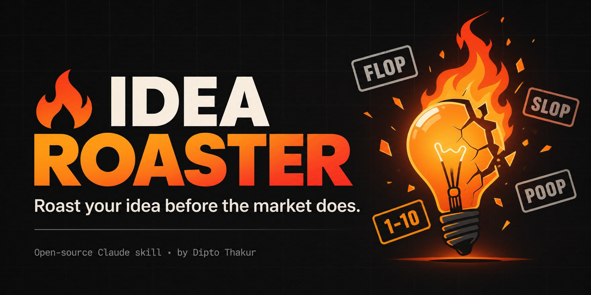

<div align="center">



# Idea Roaster

### Brutal startup idea validator for Claude. Roast your idea before the market does.

**A free, open-source Claude skill that stress-tests startup ideas, MVPs, product plans and writing with real competitor data, investor-style questions, 3-month to 5-year forecasts, and a 1–10 score. No sugarcoating. No workarounds.**

[](LICENSE)
[](https://github.com/dipto-thakur/idea-roaster)
[](https://github.com/dipto-thakur/idea-roaster)
[](https://github.com/dipto-thakur/idea-roaster/stargazers)
[](https://github.com/dipto-thakur/idea-roaster/commits/main)

[**Install**](#-install) · [**Demo**](#-demo) · [**What you get**](#-what-you-get) · [**FAQ**](#-faq) · [**Contribute**](#-contribute)

</div>

---

## ❓ What is Idea Roaster?

**Idea Roaster is a Claude skill that tries to kill your idea before the market does.** Give it a startup idea, SaaS, MVP, development plan, marketing strategy, article or any writing. It researches the web, then returns a ranked roast, real competitors, demand checks, a Shark Tank-style investor verdict, tech-leader lenses, forecasts, failed-startup case studies, a score and a category: **POOP, SLOP, FLOP, DUD, CLONE, VITAMIN or LEGIT**.

Most AI tools are people-pleasers. This one is built to disagree. It never suggests workarounds, pivots or feature padding. Its only question: **does this idea deserve to exist?**

---

### Example output (excerpt)

```text
IDEA: AI notes app for students

VERDICT: Feature, not a product. Phones, Notion and ChatGPT already do this free.

ROAST (by severity)
1. No moat. A weekend clone kills you.
2. Free substitutes everywhere.
3. No monetization hypothesis.

SHARK TANK: "I'm out."

SCORECARD
Brutality: 8/10 | Category: CLONE | Kill or Build: KILL

🔥 Roasted with Idea Roaster · by Dipto Thakur · github.com/dipto-thakur/idea-roaster
```

---

## ⚡ What you get

| Section | What it does |
|---|---|
| 🔪 **Brutal first impression** | Immediate verdict. Worst flaw first. |
| 🕵️ **Competitive intelligence** | Real competitors, pricing, traction, why users pick them over you. |
| 🌍 **Real-world demand** | Search interest ≠ demand ≠ paying users. Region-aware consumer logic. |
| 🦈 **Shark Tank panel** | CAC, LTV, margins, defensibility, founder-market fit. Ends in "I'm out" or an offer. |
| 📉 **Stock-market reality check** | Public comparables: is the market rewarding or punishing this model? |
| 🧠 **Tech-leader lenses** | Musk, Jobs, Cook, Zuckerberg, Bezos, Huang: public philosophies, never fake quotes. |
| 🔮 **Forecast** | 3 months / 6 months / 1 year / 5 years, labelled as predictions. |
| ⚰️ **Startup graveyard** | Real failed and outcompeted cases that challenge your assumptions. |
| 🎯 **Scorecard** | Brutality 1–10, category, survival odds, biggest flaw, **Kill or Build**. |

### Built-in honesty rules
- ✅ Every claim is labelled **FACT / ESTIMATE / ASSUMPTION / PREDICTION**
- ✅ Sources cited. Rival and biased sources flagged.
- ✅ **"No data found"** instead of invented numbers
- ✅ Strong ideas get a high score. It doesn't invent flaws.
- ❌ No workarounds, no pivots, no flattery

---

## 🚀 Install

### Claude Code
```bash
git clone https://github.com/dipto-thakur/idea-roaster.git
mkdir -p ~/.claude/skills/idea-roaster
cp idea-roaster/SKILL.md ~/.claude/skills/idea-roaster/
```

### Claude app (claude.ai)
1. Download `idea-roaster.skill` from [Releases](https://github.com/dipto-thakur/idea-roaster/releases).
2. Add it in Claude's skills settings.
3. Turn on **web search** so it can research real competitors and data.

### Use it
Just talk to Claude:
```text
Roast my idea: <your idea>
```
```text
Is this worth building? <your MVP plan>
```
```text
Tear this article apart: <paste writing>
```

---

## 🆚 How it compares

| | **Idea Roaster** | ValidatorAI | DimeADozen |
|---|---|---|---|
| Price | Free, MIT | Free tools | Free score, paid reports |
| Style | Brutal, kill-first | Score + next steps | Research report |
| Runs in | Claude / Claude Code | Web app | Web app |
| Fix suggestions | **None, by design** | Yes | Yes |
| Open source | **Yes** | No | No |

*Competitor details checked Nov 2026. Verify current pricing on their sites.*

---

## 🙋 FAQ

**Is Idea Roaster free?**
Yes. MIT licensed, free to use, fork and modify.

**Does it fix or improve my idea?**
No. It judges the idea as submitted. No pivots, no workarounds, no feature padding.

**Does it use real data?**
It searches the web for competitors, pricing, trends and comparables, and labels every claim. If data isn't available, it says "no data found."

**Can it roast writing and articles too?**
Yes: ideas, startups, MVPs, SaaS, business models, marketing plans, technologies, articles and publications.

**Are the Musk / Jobs / Bezos takes real quotes?**
No. They apply each leader's publicly known philosophy as a lens. No invented quotes.

**Will it always say my idea is bad?**
No. If an idea is genuinely strong, it says so and scores it high.

**Which Claude plans or apps does it work with?**
Any Claude surface that supports skills, with web search enabled.

---

## 🤝 Contribute

Found a blind spot? Better scoring, sharper lenses, new categories, more case studies?

1. Fork the repo
2. Edit `SKILL.md`
3. Open a pull request

Roast the roaster. Issues and PRs welcome.

### Repo structure
```text
idea-roaster/
├── SKILL.md            # the skill itself
├── README.md
├── LICENSE
├── CITATION.cff
└── public/             # README images, edit these freely
    ├── preview.png     # 1280×640 social preview
    ├── demo.gif
    └── screenshots/
        ├── roast-verdict.png
        ├── roast-competitors.png
        ├── roast-scorecard.png
        ├── roast-shark-tank.png
        ├── roast-lenses.png
        └── roast-forecast.png
```

---

## ⭐ Star history

[](https://star-history.com/#dipto-thakur/idea-roaster&Date)

If it killed your bad idea early, a ⭐ is the only payment asked.

---

## 📄 License & citation

Released under the [MIT License](LICENSE). Please keep the author credit in derivatives.

```bibtex
@software{thakur_idea_roaster,
  author = {Thakur, Dipto},
  title  = {Idea Roaster: a brutal startup idea validator Claude skill},
  url    = {https://github.com/dipto-thakur/idea-roaster},
  year   = {2026}
}
```

<div align="center">

**Built by [Dipto Thakur](https://github.com/dipto-thakur) · Kolkata · [Portfolio](https://diptothakur.vercel.app) · [LinkedIn](https://www.linkedin.com/in/diptothakur)**

*Roast responsibly.* 🔥

<sub>Keywords: startup idea validator, roast my startup idea, Claude skill, Claude Code skill, brutal feedback, MVP validation, Shark Tank evaluation, competitor analysis, idea validation, open source</sub>

</div>
